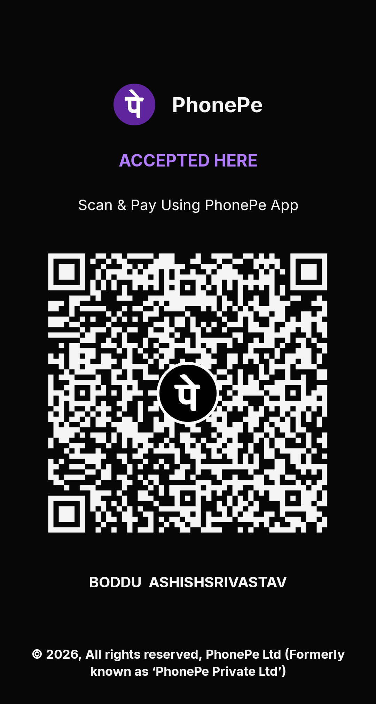

  

<h1 align="center">Vibe X</h1>

  <b>A Discord-style private messenger for Android, built on SimpleX.</b> 
  No phone number. No user IDs. No ads. Open source.

  <a href="https://github.com/blackshadowde/Vibe-X/releases/latest"><b>⬇ Download the latest APK</b></a>
  ·
  <a href="#support-vibe-x">❤ Support Vibe X</a>

---

## Why Vibe X

Vibe X is a private chat app for family and friends. It runs on the [SimpleX network](https://simplex.chat), the first messenger with **no user identifiers of any kind**: no phone number, no username, no account on a server. Nobody, not even the servers that pass your messages along, can see who you talk to.

It looks and feels like [Vibe](https://github.com/blackshadowde/Vibe-flutter): a rail of profile pictures on the left, your DMs in the middle, and chats that slide over the top. Everything moves on springs and every tap is felt.

## Features

**Chat**
- End-to-end encrypted with post-quantum (quantum-resistant) keys
- Live typing: they see your words as you type, or bouncing typing dots if you keep live typing off
- Replies with Discord-style curved lines and swipe-to-reply
- Big animated emoji, emoji bursts, heart burst on double-tap and animated reactions
- Send effects (long-press send): Like, Love, Fire, Party, LOL, Balloons and more, full screen
- Voice notes with a real waveform, pause while recording, and 1x / 1.5x / 2x playback
- Starred messages, plus every chat's media, files, links and voice notes in one place
- Disappearing messages
- Audio and video calls (WebRTC)

**Made for real life**
- 💭 **Custom status** with "Clear after", and your **local time** for friends ("2:14 AM for Ashish")
- 🗓 **Send later:** long-press send and schedule a message
- 🔒 **Locked chats** that open only with your fingerprint or PIN, with hidden notifications
- 🗄 **Archived chats** and **folders** in the rail, like Discord servers
- 📶 **Low data mode**, 💾 **save received media to your gallery**, and a **storage & cache** page
- 🔔 An **activity pill** when someone writes in another chat
- 🌐 **Find public groups** through SimpleX's directory
- 👋 **Log out / log in** with an encrypted backup file

**The Vibe look**
- Discord-style palette in light and dark mode, with text size and haptics settings
- Profile pages with a full-width picture header
- Google Messages style photo viewer with a thumbnail strip, Discord-style link cards
- Voice and video calls in Vibe's look
- Slide-up panes instead of pop-up menus
- In-app updates: new versions download and install from inside the app

**Private by design (SimpleX)**
- No phone number, email or username needed to start
- Your profile, contacts and messages live only on your phone, in an encrypted database
- Connect by link or QR code; you choose the servers, or run your own
- Works over Tor (SOCKS proxy)

## Download and install

1. Open the [latest release](https://github.com/blackshadowde/Vibe-X/releases/latest) on your Android phone.
2. Tap **`vibe-x-…-arm64-v8a.apk`** (most phones). Older 32-bit phones: `armeabi-v7a`.
3. Open the file. If Android asks, allow **Install unknown apps** for your browser.
4. Create your profile (just a name) and share your link or QR code with friends.

To update, use **Settings → Updates**, or install the new APK over the old one. Your chats stay.

**Moving to a new phone or reinstalling:** export your database first (Settings → Database passphrase & export). Your chats exist only on your phone, so without an export they can't be recovered.

## Support Vibe X

Vibe X is free, with no ads and no tracking. It is built by one person. If you'd like to help pay for development and testing:

   
  <b>UPI:</b> <code>ashish.boddu@ybl</code>

You can also donate from inside the app: **Settings → Support Vibe X**. Thank you! ❤

## Privacy

- Messages, files and calls are end-to-end encrypted, with keys that only exist on your devices.
- The servers relay encrypted messages and can't see who is talking to whom: SimpleX has no user identifiers.
- Vibe X has no analytics and no ads.
- The only extra connection Vibe X makes is to GitHub, to check for updates (through your proxy, if you use one), and to Google's emoji server for animated emoji (skipped when you use a proxy).

## For developers

Builds run on GitHub Actions, so no local setup is needed.

- **Vibe X build** (Actions): builds the signed APKs. Tick **Also publish the APK as a GitHub release** to make a public release. Release notes are made from the commit messages since the last release, and the in-app updater compares the build number at the end of the tag (`vibe-x-7.0.4-57`).
- **Vibe X check** (Actions): compiles the app quickly to catch errors.

Only the app (Kotlin, Compose Multiplatform) is built here. SimpleX's core library (`libsimplex.so`, written in Haskell) is taken from the official SimpleX release with the same version, so messaging, encryption and calls are exactly SimpleX's.

The Vibe X look lives in `apps/multiplatform/common/src/commonMain/kotlin/chat/simplex/common/views/vibe/`.

Release secrets (Settings → Secrets and variables → Actions):

| Secret | What it is |
| --- | --- |
| `ANDROID_KEYSTORE_BASE64` | base64 of the signing keystore |
| `ANDROID_KEYSTORE_PASSWORD` | keystore password |

Keep the keystore backed up outside the repository. Without it, installed apps can't be updated.

## Credits and licence

Vibe X is a fork of [SimpleX Chat](https://github.com/simplex-chat/simplex-chat) by SimpleX Chat Ltd and contributors, licensed under **AGPL-3.0**. Vibe X keeps that licence; see `LICENSE`. SimpleX's own README is kept in [README-SimpleX.md](README-SimpleX.md).

Its look comes from [Vibe](https://github.com/blackshadowde/Vibe-flutter). Animated emoji: [Noto Animated Emoji](https://googlefonts.github.io/noto-emoji-animation/) by Google (CC BY 4.0).

Vibe X is not made by or affiliated with SimpleX Chat Ltd or Discord.

Keywords: SimpleX client, Android messenger, Discord style chat, end-to-end encryption, post-quantum, private messenger, no phone number, no user IDs, SimpleX fork, Kotlin, Compose.
